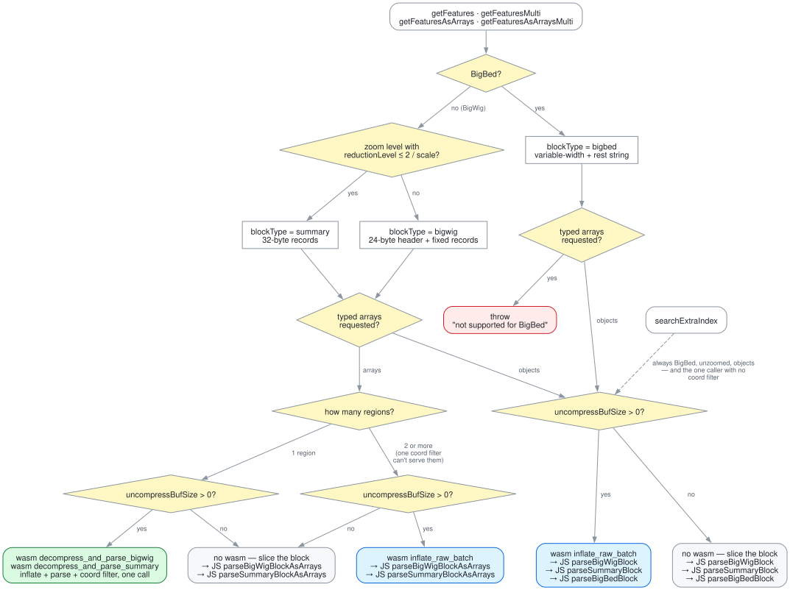

# Which parser runs

Four parsers read the same records: a JS object parser, a JS typed-array parser,
and a pair of fused wasm parsers. Which one runs depends on whether the file is
compressed, whether the caller asked for objects or arrays, and whether it named
one region or several. The API does not show the choice, so this page is for
contributors, and for anyone reading a stack trace that names a function they
never called.

- [The chart](#the-chart)
- [The four questions](#the-four-questions)
- [The leaves](#the-leaves)
- [Why they have to agree](#why-they-have-to-agree)
- [Regenerating the chart](#regenerating-the-chart)

## The chart



Source: [`parser-selection.dot`](img/parser-selection.dot). Green marks a leaf
that parses in wasm, blue one that inflates in wasm and parses in JS, and grey
one that uses no wasm at all. The dashed edge is `searchExtraIndex`, which joins
below the reader question because it is never a typed-array read.

## The four questions

### 1. BigBed or BigWig, and at what zoom — `getView`

`BBI._getView` resolves a `scale`/`basesPerSpan` option into a `BlockView` over
one on-disk index, and the index it picks fixes the record layout for everything
downstream:

| `blockType` | Layout                                 | Chosen when                                           |
| ----------- | -------------------------------------- | ----------------------------------------------------- |
| `bigbed`    | variable-width, trailing `rest` string | any BigBed read                                       |
| `summary`   | 32-byte fixed records                  | BigWig, coarsest zoom with `reductionLevel ≤ 2/scale` |
| `bigwig`    | 24-byte header + fixed-width records   | BigWig, no zoom level matched                         |

`BigBed.getView` ignores `scale` entirely and always returns the unzoomed view,
so bbi-js never reads the zoom levels `bedToBigBed` wrote.

### 2. Objects or typed arrays — which reader the caller used

`getFeatures`/`getFeaturesMulti` build one `Feature` object per record.
`getFeaturesAsArrays`/`getFeaturesAsArraysMulti` fill packed typed arrays and
allocate no per-record object.

The typed-array readers reject BigBed rather than mis-parsing it. Their parsers
handle only the fixed-width layouts, and a `rest` string does not fit a
fixed-width column. The BigWig parser, given BigBed bytes, returns records that
look plausible and are garbage, so `assertNotBigBed` throws instead.

`BigBed.searchExtraIndex` is a fifth entry point, which starts from a name
lookup rather than a coordinate query. It calls `readFeatures` directly, so it
always reads BigBed, unzoomed, as objects. It is also the only caller that
passes no `request`, so it parses its blocks whole, skips the coord filter, and
filters by name afterwards.

### 3. One region or several — the fused call takes one coord filter

The fused wasm entry points take a single `[reqStart, reqEnd)` and filter as
they parse. A multi-region call has one filter per region and one shared set of
blocks, so there is no single range to pass to wasm. When two overlapping
regions share a block, the reader fetches it once and parses it once for each
region that tags it.

A call with two or more regions therefore inflates raw and parses in JS, once
per region tag. A call with one region takes the single-region path rather than
a multi-region path with one entry. Every single-locus consumer sends that
request, and the multi-region path would cost it the fused parse, the per-block
chunk allocations and the `packChunks` copy, with nothing to dedupe, merge or
pack across.

### 4. Compressed or not — `uncompressBufSize`

A BBI file records the size of its largest uncompressed block in the header, or
`0` when the writer left blocks uncompressed (`bedGraphToBigWig -unc` and
similar tools). When the value is zero, the reader slices blocks straight out of
the fetched group and no path calls into wasm, including the one that would
otherwise use a fused call. The fused entry points _are_ the decompressor, so no
version of them skips decompression.

The `uncompressBufSize` branch is the only one that can change which language
parses your data between two files that look identical through the API.

## The leaves

| Leaf                                                    | Reached by                                   | Runs                                            |
| ------------------------------------------------------- | -------------------------------------------- | ----------------------------------------------- |
| `decompress_and_parse_bigwig` / `..._summary`           | typed arrays, BigWig, 1 region, compressed   | inflate + parse + coord filter in one wasm call |
| `inflate_raw_batch` → `parse*BlockAsArrays`             | typed arrays, BigWig, ≥2 regions, compressed | wasm inflate, JS array parse per region tag     |
| `parse*BlockAsArrays`                                   | typed arrays, BigWig, uncompressed           | JS array parse, no wasm                         |
| `inflate_raw_batch` → `parseBigWig/Summary/BigBedBlock` | objects or `searchExtraIndex`, compressed    | wasm inflate, JS object parse                   |
| `parseBigWig/Summary/BigBedBlock`                       | objects or `searchExtraIndex`, uncompressed  | JS object parse, no wasm                        |

The reader passes every block of a group to `inflate_raw_batch` in one call
rather than one call per block; [wasm.md](./wasm.md) explains why the batching
and the fused parse are designed that way.

## Why they have to agree

A caller does not choose a leaf, so every leaf has to produce the same answer
for the same bytes — including when the bytes are wrong.

**Records.** `test/parser-parity.test.ts` sweeps the object and array parsers
against each other over every test file and three zoom levels, including windows
whose edges fall exactly on a record's boundaries. Without those edge windows an
off-by-one coord filter agrees with a correct one on every file here. The test
compares scores through `Math.fround`, since the object parsers keep the summary
mean as a double where the arrays round it to f32.

**Errors.** On a block shorter than its header declares, the wasm and JS parsers
raise the same `truncated <kind> block` error. Each checks the block against its
declared item count before sizing the output arrays. Without the check, wasm
would return the records that fit, and JS would throw a bare `DataView`
`RangeError`. A well-formed file never contains a partial record, because a
section declares its item count and a zoom block is a whole number of 32-byte
records, so the check cannot fire on valid data. An unchecked short block would
leave a track missing data with no error to explain it.

The guard is deliberately in two places, `src/block-view.ts` and
`crate/src/lib.rs`, because each read passes through only one of them, and the
chart above shows which.

**Routing.** Because the parsers agree, a call routed to the wrong parser still
returns correct features, so `test/parser-dispatch.test.ts` checks which parser
each call reaches by counting calls through `src/unzip.ts`. Every wasm entry
point goes through that module, so a test can assert "fused, and no raw inflate"
or "no wasm at all" and check it against the counts.

`parser-parity.test.ts` and `parser-dispatch.test.ts` catch different bugs. If
you delete the one-region special case in `readWigDataAsArraysMulti`, every read
still returns identical features, so `parser-parity.test.ts` passes while the
fused call stops running, and only the dispatch test fails. Each dispatch case
also asserts that it produced features, because a query that overlaps no blocks
reaches no parser and would otherwise pass every "no wasm" expectation without
parsing anything.

## Regenerating the chart

```bash
dot -Tsvg docs/img/parser-selection.dot -o docs/img/parser-selection.svg
```

Git tracks both the `.dot` and the rendered `.svg`, so reading the docs needs no
graphviz.
